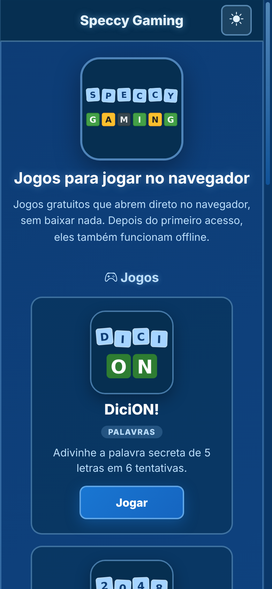
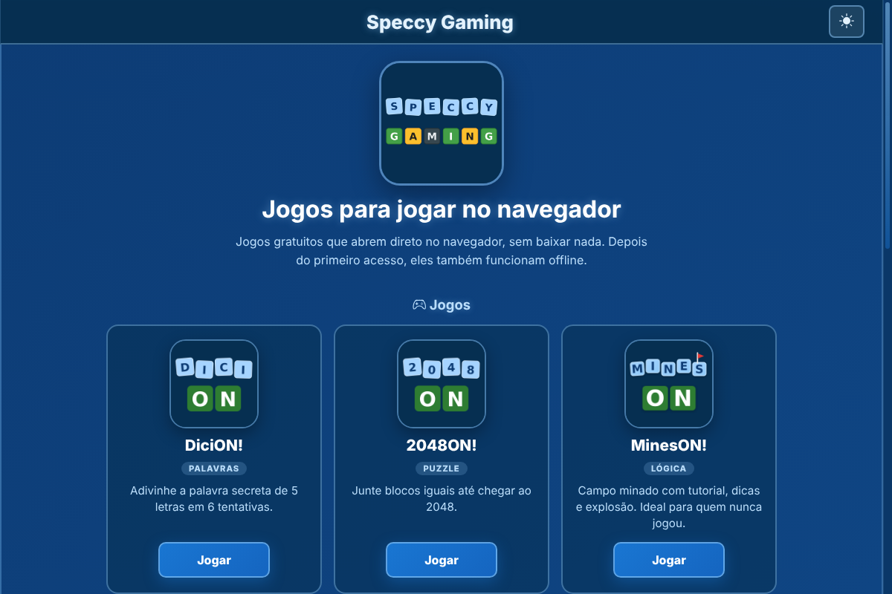

# Speccy Gaming (hub)

Página inicial dos jogos ON!: um catálogo com a mesma paleta azul, os links das redes e o QR Pix. A lista de jogos mora aqui: os jogos só têm, no menu ☰, um atalho "Outros Jogos" que abre esta página.

**Endereço:** https://speccygames.netlify.app/

<p align="center">
  
  &nbsp;&nbsp;
  
</p>

## Por que existe

Para divulgar um jogo novo (ou mudar um nome, ícone ou descrição) basta mudar **só a hub**. Os jogos têm apenas o atalho "Outros Jogos" apontando para cá, então não precisam de novo deploy.

## Adicionando um jogo

1. Ponha o ícone (quadrado, 256 a 512 px, PNG) em `img/`, por exemplo `img/novojogo.png`.
2. Acrescente um item em `jogos.json`:

```json
{
  "id": "novojogo",
  "nome": "NovoJogo!",
  "descricao": "Frase completa para o cartão da hub.",
  "curta": "Frase curta para o menu dos jogos",
  "url": "https://novojogo.netlify.app/",
  "icone": "img/novojogo.png",
  "tag": "Puzzle"
}
```

3. Publique a hub. Não precisa mexer em mais nada: a página lê o JSON a cada visita (rede primeiro) e o service worker guarda o ícone novo na primeira vez que ele aparece. Nada de nome de jogo fica escrito no HTML, no JS ou no service worker.

Campos opcionais: `"novo": true` mostra o selo Novo no cartão, e `"ativo": false` esconde o jogo sem apagar a entrada. A ordem dos cartões é a ordem do arquivo.

Regras: `url` precisa ser `https://`; `icone` pode ser relativo (resolvido contra a hub). O `id` de cada jogo é usado para marcar "você está aqui" no menu.

## Como a hub se liga aos jogos

A hub usa o `on.js` só para os ícones SVG e a lista de redes (`ON.icone`, `ON.redes`), a mesma dos jogos. Ela própria lê `jogos.json` (rede primeiro, com cópia em `localStorage` para abrir offline). Como os jogos não leem esse arquivo, não há CORS: o `_headers` só cuida do cache (`service-worker.js` sem cache, `jogos.json` revalidando).

## Estrutura

```
.
├── index.html
├── on.css, on.js         base compartilhada ON! (igual à dos jogos; aqui o on.js só dá os ícones e as redes)
├── hub.css / hub.js      estilos e lógica da hub (monta os cartões a partir do JSON)
├── jogos.json            lista dos jogos
├── _headers              cache do Netlify
├── manifest.json, service-worker.js
├── img/                  logo da hub e ícones dos jogos
├── screenshots/
└── assets/               ícones, favicon e QR Pix
```

## Rodando localmente

```bash
python3 -m http.server 8000
# abra http://localhost:8000
```

Localmente os jogos continuam lendo a lista de `speccygames.netlify.app`, não da sua pasta.

## Publicando (Netlify)

Arraste a pasta (ou ligue o repositório) sem build, com publish directory na raiz. O subdomínio `speccygames` precisa estar livre na sua conta; se não estiver, escolha outro em *Site configuration → Change site name* e atualize a constante `HUB` em `on.js` (cópia em `Base-Compartilhada/_shared/`, sincronizada com `sync.ps1`) e as URLs deste README.

## Família ON!

Mesmo visual, mesma base: **DiciON!**, **2048ON!**, **MinesON!** e **ChezzON!**.

---

Feito por Christian ([@Christian5910](https://github.com/Christian5910)).
